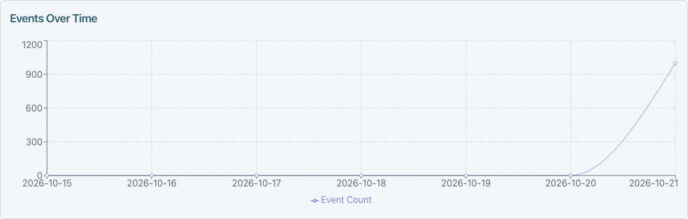
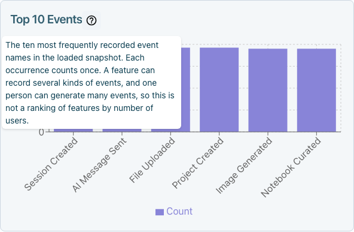

# Admin Dashboard Overview

The Bike4Mind admin dashboard is the central hub for platform administration. It provides tools for managing users, monitoring system health, configuring settings, and analyzing platform usage. Access is restricted to users with admin privileges; non-admin users see an "Admin Access Only" message.

## Layout

The admin panel is organized as a full-screen view with three main areas:

| Area | Description |
|------|-------------|
| **Environment Banner** | A color-coded sticky bar at the top indicating the current environment |
| **Left Sidebar** | An accordion-based navigation menu for switching between admin tabs |
| **Main Content Area** | The active tab's content, occupying the majority of the screen |

## Keyboard commands

On the admin page or a user profile, press Cmd/Ctrl+K to open **Admin commands**. Use ArrowUp and ArrowDown to select a command, Enter to run it, and Escape to close the palette. You can navigate to Users, Organizations, settings or the audit log, or paste a user ID to open its profile. **Open Help Center** opens the existing help panel; `?` now shows the shortcut list instead. Use the Users or Organizations page search for name and email lookup.

| Key | Action |
|-----|--------|
| `/` | Focus the current page's supported search field, or the sidebar filter when the page has none |
| `x` | Toggle selection of a focused selectable shared-table row or Slim Users row/card |
| `c` | Open Overview and focus Credit balance on a user profile; use Update with a reason to save |
| `s` | Open an audited suspension preview for the user whose profile is open |
| Cmd/Ctrl+S | On Admin Settings, save all staged changes across sections; in standalone editors, save the current setting |
| `?` | Open shortcut help |

The profile also offers **Revoke API keys**. Suspension and key revocation require an eligibility preview and a reason before you apply them. These flows exclude paid, admin, system and organization accounts, and do not claw back credits. Suspension also revokes API keys and signs the user out.

### If a shortcut does nothing

Single-key shortcuts (`/`, `x`, `c`, `s`, `?`) do not run while you type in an input or editable text. No shortcut runs while a menu or dialog is open. Close the popup, or Tab out of the field to the intended row first. On Settings, Cmd/Ctrl+S saves staged edits across sections. Scoped overrides, uploads and command actions use their own controls; standalone bespoke forms keep their own Save controls. A disabled save button still needs a valid change. If `/` does nothing, use the page's search control directly.

## Environment Banner

The environment banner is always visible at the top of the admin panel. It uses color coding to clearly indicate which environment you are working in, reducing the risk of unintended changes in production.

| Environment | Color | Hostname Pattern |
|-------------|-------|-----------------|
| Local Development | Green | `localhost` |
| Staging | Blue | Contains `staging` |
| Production | Red | `app.bike4mind.com` |
| Unknown | Yellow | Any other hostname |

The banner includes a close button on the right side that navigates back to the previous page.

## Dashboard Landing Page

The admin panel opens on **Dashboard** by default. You can link directly to it with `/admin?tab=dashboard`; a link to another tab still opens that tab.

- **Client usage** shows a chart and table of users and events by source, including Web, Desktop, and CLI. Sources can also describe entry points or automatic/manual triggers, so this is not a comparison of clients alone. Choose the last 24 hours, 7 days, or 30 days. Only events with source metadata are included. A user active in several sources is counted in each source's row, so adding the user counts does not give a distinct overall user count. The chart shows users per source; **Event share** measures each source's percentage of recorded events. Hover over, focus, or tap the help icons beside source names and metrics for explanations. Source help also shows the original recorded value; unrecognized values stay visible with a note that no explanation is available yet.
- **More dashboards** appears when an installed extension contributes a dashboard entry. Each card opens that extension's registered route; the destination keeps its existing access rules.
- **Explore admin** opens Feature activity (Event Metrics), User activity & reports (Analytics), Model performance (Model Metrics), Credits & costs (Credit Analytics), Users, and System health.
- **Recent activity** shows events over time, categories, and the top tracked events across the last 7 UTC calendar days, including today. The server counts all matching events, so a busy day does not push earlier days out of the report. The time chart includes all seven dates, with zero for days without activity. Today is incomplete. These are event counts, not distinct users or a complete measure of feature adoption. The client usage chart has its own time range.

Use **Refresh activity** to reload the activity summary. While activity loads or fails, client usage and the navigation shortcuts remain available. An empty summary means no matching events were recorded during the seven-day window; a request failure displays an error instead. If client usage is empty, check its selected time range: older events without source metadata do not appear there.

This sample shows a busy day alongside earlier dates, including days with no events:

Help icons across the landing page explain client types, events, categories, AI model response times, costs, and the activity summary's coverage. The three activity charts also have help: **Events Over Time** counts all recorded events by UTC date on the landing page, **Events by Category** groups related actions, and **Top 10 Events** ranks event names by frequency. These charts count recorded events, not distinct people. Recent activity uses UTC dates and includes zero-activity days; today is incomplete. Detailed Event Metrics uses the browser's time zone and shows dates with loaded events. Hover over, focus, or tap a help icon to read its explanation.

The example below uses sample events to show the chart help:

## Sidebar Navigation

The **Dashboard** button stays above the collapsible sidebar sections, so you can always return to the overview. On a narrow screen, open the admin menu to reach it. Each section can be independently expanded or collapsed, and your preferences are saved.

### User Ops

The User Ops section contains tabs focused on user and account management:

| Tab | Description |
|-----|-------------|
| Users | Search, view, edit, and manage user accounts |
| Email Verification | Monitor and manage email verification status |
| Feedback | Review and triage user-submitted feedback |
| Migration | Bulk migrate users into the platform (conditional, requires feature flag) |
| Analytics | View user activity reports and analytics |
| Invite Codes | Manage registration invite codes |
| Waitlist | View waitlist requests and generate invites (shows a badge count for people waiting for an invite) |
| Email Marketing | Email marketing campaigns |
| Subscriptions | Manage user subscriptions |
| Organizations | Manage organizations |
| Credit Analytics | Analyze credit usage across the platform |
| Bulk Import | Import users in bulk |
| Team | Manage team members |

### General Ops

The General Ops section contains tabs for system configuration and operational tools:

| Tab | Description |
|-----|-------------|
| Admin Settings | Platform-wide configuration settings |
| System Health | Monitor system health status |
| LLM Dashboard | Large language model configuration and monitoring |
| Tool Definitions | Manage tool definitions available to AI |
| Rapid Reply | Configure rapid reply templates |
| System Prompts | Manage system-level prompts |
| Agent Operations | Monitor and manage AI agent operations |
| Documentation | Internal documentation management |
| Modals | Configure application modals |
| What's New | Manage "What's New" announcement modals |
| LiveOps Triage | Live operations triage (conditional, hidden on fork production environments) |
| Secrets Rotation | Manage secret rotation schedules |
| System Secrets | View and manage system secrets |
| Identity Providers | Configure identity provider integrations |
| Slack Workspaces | Manage Slack workspace connections |
| Model Metrics | View model performance metrics |
| Event Metrics | Track system event metrics |
| Slack Metrics | Monitor Slack integration metrics |
| Security Dashboard | Security monitoring dashboard |

### Advanced

The Advanced section contains specialized tools:

| Tab | Description |
|-----|-------------|
| World Time | View current time across different time zones |

## Tab System

The admin panel uses a vertical tab system where clicking a sidebar button activates the corresponding tab in the main content area. Tabs are lazy-loaded, meaning their content is only rendered when the tab is active, which improves initial load performance. Several tabs use dynamic imports via `next/dynamic` for code splitting.

## Default Tab Behavior

- The default active tab is **Dashboard** when the admin panel first opens. Selecting another tab keeps it active during the current app session and updates the URL.

## Notification Badges

The Waitlist tab displays a notification badge when people are waiting for an invite. The badge shows the count of people waiting and can be dismissed. This badge is only visible when the count is greater than zero and the notification has not been hidden.

## Best Practices

- Always check the environment banner color before making changes to confirm you are in the intended environment.
- Use the sidebar accordion collapse feature to reduce visual clutter when working within a specific section.
- The admin panel requires the `isAdmin` flag on the current user -- ensure admin privileges are granted appropriately through the Users tab.

---

## Related Articles

- [User Management](./user-management.md) - Managing user accounts
- [Email Verification](./email-verification.md) - Email verification administration
- [Feedback](./feedback.md) - Feedback triage and management
- [Analytics](./analytics.md) - Platform analytics and reporting
